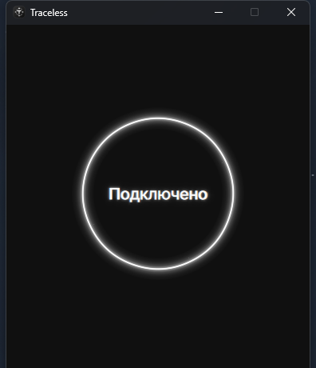
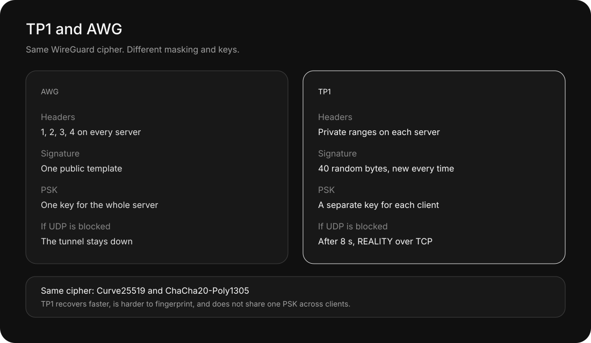
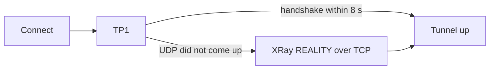

# Traceless VPN

Self-hosted VPN client for your own server.

### [English](README.md) | [Русский](README_RU.md)



Traceless installs a VPN on a server you control and connects to it. The main profile is TP1: AmneziaWG 3.1 with a private header profile, a per-client preshared key, and a TCP fallback when UDP does not come up.

This project is based on [Amnezia VPN](https://github.com/amnezia-vpn/amnezia-client). Amnezia remains the upstream project. Traceless is distributed under the same [GNU GPL v3.0](LICENSE).

## TP1

TP1 uses the same cipher as AWG: Curve25519 and ChaCha20-Poly1305. The difference is how the tunnel is hidden and how keys are issued.



| | AWG | TP1 |
| --- | --- | --- |
| Headers H1–H4 | Shared values 1, 2, 3, 4 | Private ranges per server |
| Pre-handshake packet | A fixed public template | 40 random bytes, no stable fingerprint |
| Header protection | Present on new 3.1 configs, absent on AWG 1.5/2 | Required |
| PSK | One key for the whole server | A separate key for each client |
| Cookies | Off in the 3.1 profile | On, so the server can drop handshake floods |
| Length padding | 10–100 bytes | 1–8 bytes, so packets stay unfragmented |
| Handshake retry | 3–7 s, 15–20 attempts | 2–3 s, 30–40 attempts |
| When UDP fails | The tunnel does not come up | After 8 s, switch to XRay REALITY over TCP |

Keys that are already issued stay valid. The header-protection key, H1–H4 ranges, S1–S4 padding and the PSK are not rotated.




## Build

Requirements: CMake, a C++ toolchain, Qt 6.10 or newer (Core, Gui, Network, Quick, Svg, and the Compat, RemoteObjects, HttpServer modules), Conan, and Qt Installer Framework for the Windows package.

```bat
deploy\build.bat -i ifw
```

```bash
deploy/build.sh
```

After checkout, load the submodules:

```bash
git submodule update --init --recursive
```

The Windows installer is produced in the build directory as `Traceless_<version>_windows_x64.exe`. The `deploy/build` directory is generated output and is not part of the source tree.

## Credits

- [Amnezia VPN](https://github.com/amnezia-vpn/amnezia-client) — the client this project is based on
- [AmneziaWG](https://docs.amnezia.org/documentation/amnezia-wg/), WireGuard, XRay, OpenVPN, OpenSSL, Qt

## License

[GNU General Public License v3.0](LICENSE).
