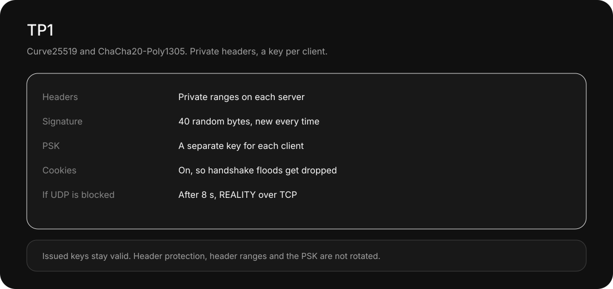
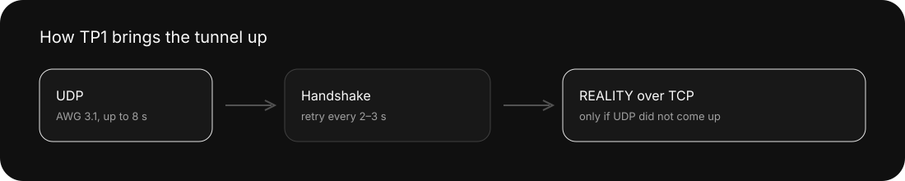

# Traceless VPN

Self-hosted VPN client for your own server.

### [English](README.md) | [Русский](README_RU.md)


Traceless installs a VPN on a server you control and connects to it. The profile is TP1: private headers, a preshared key for each client, and a TCP fallback when UDP does not come up.

This project is based on [Amnezia VPN](https://github.com/amnezia-vpn/amnezia-client). Amnezia remains the upstream project. Traceless is distributed under the same [GNU GPL v3.0](LICENSE).

## TP1

Curve25519 and ChaCha20-Poly1305. Each server gets its own header ranges, header protection is required, and every client gets its own preshared key.



| | TP1 |
| --- | --- |
| Headers H1–H4 | Private ranges per server |
| Pre-handshake packet | 40 random bytes, no stable fingerprint |
| Header protection | Required |
| PSK | A separate key for each client |
| Cookies | On, so the server can drop handshake floods |
| Length padding | 1–8 bytes, so packets stay unfragmented |
| Handshake retry | 2–3 s, 30–40 attempts |
| When UDP fails | After 8 s, switch to XRay REALITY over TCP |

Keys that are already issued stay valid. The header-protection key, H1–H4 ranges, S1–S4 padding and the PSK are not rotated.



```mermaid
flowchart LR
<<<<<<< HEAD
  click[Connect] --> udp[TP1 over UDP]
=======
  click[Connect] --> udp[TP1]
>>>>>>> fb4b04bafe110bd70bed1055fe9e5abd819126da
  udp -->|handshake within 8 s| up[Tunnel up]
  udp -->|UDP did not come up| reality[XRay REALITY over TCP]
  reality --> up
```

## Build

Requirements: CMake, a C++ toolchain, Qt 6.10 or newer (Core, Gui, Network, Quick, Svg, and the Compat, RemoteObjects, HttpServer modules), Conan, and Qt Installer Framework for the Windows package.

```bat
deploy\build.bat -i ifw
```

```bash
deploy/build.sh
```

After checkout, load the submodules:

```bash
git submodule update --init --recursive
```

The Windows installer is produced in the build directory as `Traceless_<version>_windows_x64.exe`. The `deploy/build` directory is generated output and is not part of the source tree.

## Credits

- [Amnezia VPN](https://github.com/amnezia-vpn/amnezia-client) — the client this project is based on
- [AmneziaWG](https://docs.amnezia.org/documentation/amnezia-wg/), WireGuard, XRay, OpenVPN, OpenSSL, Qt

## License

[GNU General Public License v3.0](LICENSE).
