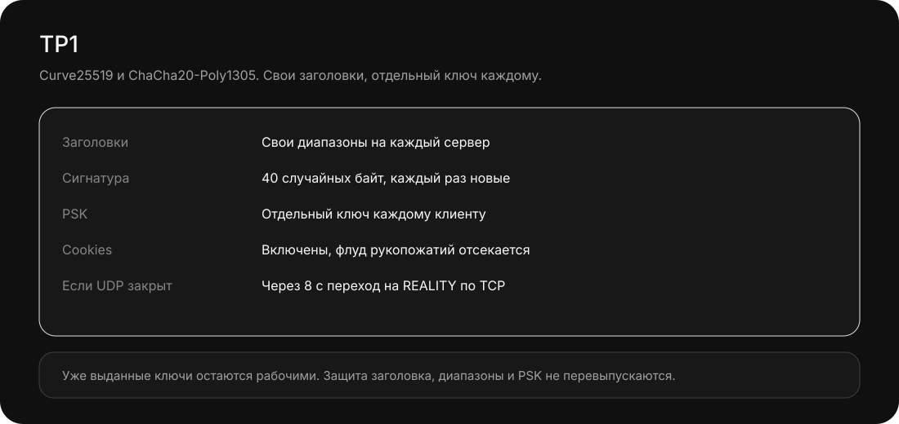
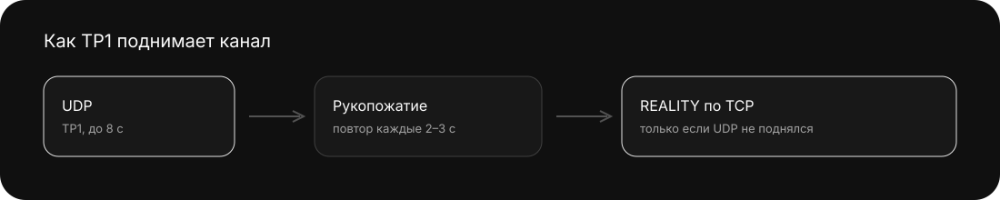
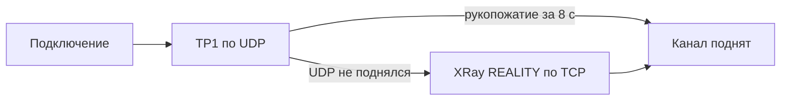

# Traceless VPN

VPN-клиент для собственного сервера.

### [English](README.md) | [Русский](README_RU.md)


Traceless ставит VPN на сервер, который вы контролируете, и подключается к нему. Профиль — TP1: свои заголовки, отдельный PSK каждому клиенту и переход на TCP, если UDP не поднимается.

Проект основан на [Amnezia VPN](https://github.com/amnezia-vpn/amnezia-client). Amnezia остаётся исходным проектом. Traceless распространяется под той же [GNU GPL v3.0](LICENSE).

## TP1

Curve25519 и ChaCha20-Poly1305. У каждого сервера свои диапазоны заголовков, защита заголовка обязательна, у каждого клиента свой PSK.



| | TP1 |
| --- | --- |
| Заголовки H1–H4 | Свои диапазоны на каждый сервер |
| Пакет перед рукопожатием | 40 случайных байт, без постоянного отпечатка |
| Защита заголовка | Обязательна |
| PSK | Отдельный на каждого клиента |
| Cookies | Включены, сервер отсекает флуд рукопожатий |
| Добавка длины | 1–8 байт, пакет не дробится |
| Повтор рукопожатия | 2–3 с, 30–40 попыток |
| Если UDP не проходит | Через 8 с переход на XRay REALITY по TCP |

Уже выданные ключи остаются рабочими: ключ защиты заголовка, диапазоны H1–H4, S1–S4 и PSK не перевыпускаются.





## Сборка

Нужны CMake, компилятор C++, Qt 6.10 или новее, Conan и Qt Installer Framework для установщика Windows.

```bat
deploy\build.bat -i ifw
```

```bash
deploy/build.sh
```

После клонирования подтяните подмодули:

```bash
git submodule update --init --recursive
```

Установщик Windows появляется в каталоге сборки как `Traceless_<версия>_windows_x64.exe`. Папка `deploy/build` — результат сборки, в исходники она не входит.

## Кредиты

- [Amnezia VPN](https://github.com/amnezia-vpn/amnezia-client) — клиент, на котором основан этот проект
- [AmneziaWG](https://docs.amnezia.org/documentation/amnezia-wg/), WireGuard, XRay, OpenVPN, OpenSSL, Qt

## Лицензия

[GNU General Public License v3.0](LICENSE).
