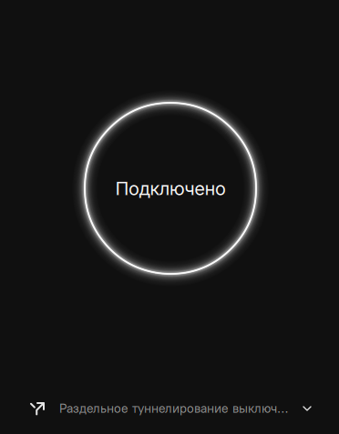

# Traceless VPN

VPN-клиент для собственного сервера.

### [English](README.md) | [Русский](README_RU.md)



Traceless устанавливает VPN на ваш сервер и управляет подключением через профиль TP2.

Проект основан на [Amnezia VPN](https://github.com/amnezia-vpn/amnezia-client). Amnezia остаётся исходным проектом. Traceless распространяется под той же [GNU GPL v3.0](LICENSE).

## TP2 и AmneziaWG

TP2 — профиль Traceless на базе AmneziaWG 3.1. Для обмена ключами используется Curve25519, для шифрования и аутентификации трафика — ChaCha20-Poly1305. Traceless задаёт параметры профиля, выдаёт ключи и управляет подключением. [Документация AmneziaWG 3.1](https://github.com/amnezia-vpn/amneziawg-go/blob/v3.1.20260814/README.md#configuration) · [Криптография WireGuard](https://www.wireguard.com/protocol/)

| Возможность | AmneziaWG 3.1 | TP2 в Traceless |
| --- | --- | --- |
| Заголовки пакетов | Настраиваемые диапазоны H1–H4 и опциональная защита заголовков | При установке создаются отдельные диапазоны для каждого сервера. Профиль требует защиты заголовков и проверяет диапазоны на пересечения. |
| Ключи клиентов | Поддерживает отдельный PSK для каждого клиента | Traceless генерирует отдельный PSK при выдаче каждого клиентского профиля. |
| Размер пакетов | Поддерживает настраиваемый padding | По умолчанию добавляет до 8 байт к данным. Клиент рассчитывает MTU туннеля с учётом MTU сетевого интерфейса, внешнего IPv4 или IPv6 и накладных расходов TP2. |
| Рукопожатие | Поддерживает настройку интервала и числа повторов | Штатный профиль использует интервал повтора 2–3 секунды и значение MaxHandshakeAttempts 12–16. Cookies включены. |
| Запасное подключение | Туннель AmneziaWG использует UDP | На поддерживаемых настольных сборках Traceless может перейти на отдельное подключение XRay REALITY по TCP. |

**TCP-резерв** доступен, когда на том же сервере настроен профиль XRay REALITY и оба режима Kill Switch выключены. При наличии резерва клиент отводит до 8 секунд на первое рукопожатие TP2 по UDP, прежде чем начать переход.

### Переход с TP1

1. Откройте настройки протокола сервера в профиле с SSH-доступом и выберите **Обновить протокол до TP2**.
2. Сверьте отпечаток SSH с ключом своего сервера и подтвердите обновление.

Для штатного TP1 обновление применяется к работающему интерфейсу. Адрес, порт, параметры заголовков и выданные ключи сохраняются, поэтому клиентские профили можно продолжать использовать. При ошибке применения Traceless пытается восстановить прежний параметр.

## Сборка

Нужны CMake, компилятор C++, Qt 6.10 или новее, Conan и Qt Installer Framework для установщика Windows.

```bat
deploy\build.bat -i ifw
```

```bash
deploy/build.sh
```

После клонирования подтяните подмодули:

```bash
git submodule update --init --recursive
```

Установщик Windows появляется в каталоге сборки как `Traceless_<версия>_windows_x64.exe`. Папка `deploy/build` — результат сборки, в исходники она не входит.

## Кредиты

- [Amnezia VPN](https://github.com/amnezia-vpn/amnezia-client) — клиент, на котором основан этот проект
- [AmneziaWG](https://docs.amnezia.org/documentation/amnezia-wg/), WireGuard, XRay, OpenVPN, OpenSSL, Qt

## Лицензия

[GNU General Public License v3.0](LICENSE).
